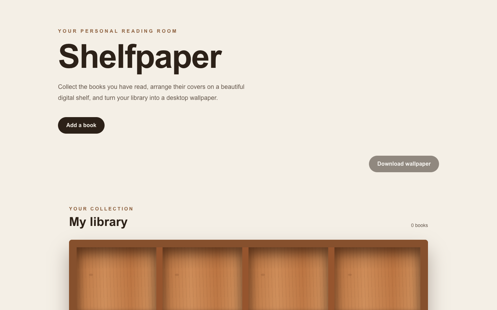
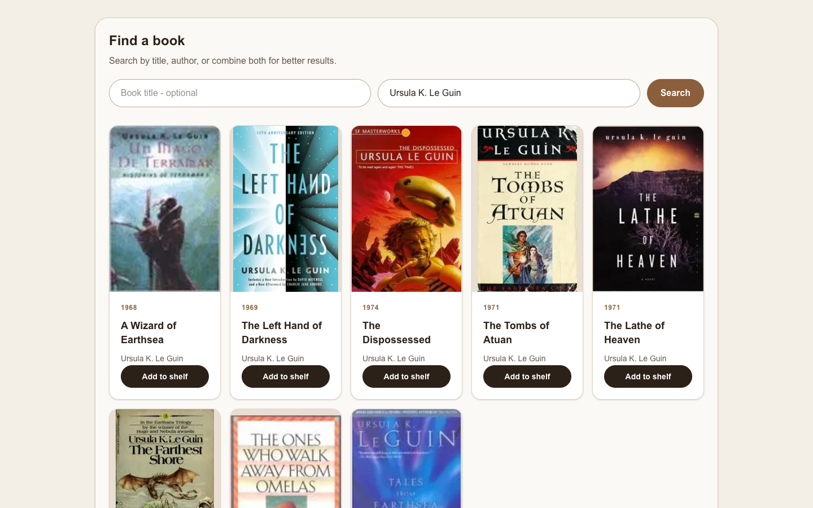
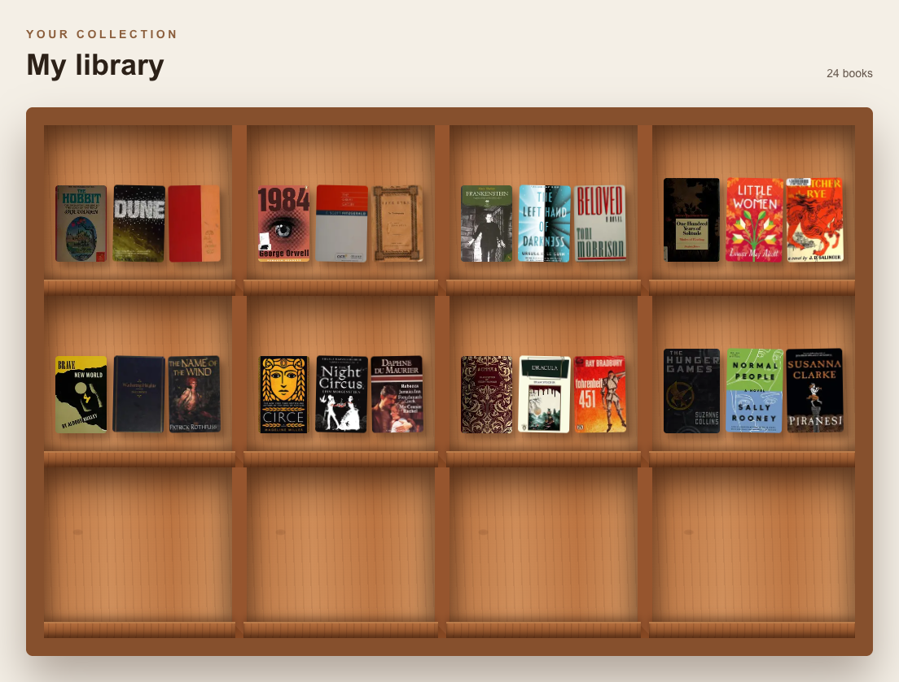

# Shelfpaper

**Your personal reading room.** Collect the books you've read, arrange their covers on a wooden bookcase, and turn your library into a high-resolution desktop wallpaper.



## Features

- **Book search**: find books by title, author, or both, powered by the [Open Library](https://openlibrary.org/developers/api) search API. Results come with real cover art.
- **Personal library**: add books to a twelve-compartment bookcase that holds three books per compartment. Hover over a book and click **×** to remove it.
- **Spines view**: switch the bookcase to show books spine-out, like a real shelf. Each spine takes its colour from the book's cover and its thickness from the page count, so the shelf fits 100+ books instead of 36.
- **Saved automatically**: your library is stored in your browser's `localStorage`, so it's still there when you come back.
- **Wallpaper export**: one click renders your bookcase as a 3024 × 1964 PNG, sized for a MacBook Pro display, using [`html-to-image`](https://github.com/bubkoo/html-to-image).

## Screenshots

### Search for a book

Search by title, author, or both, then add any result to your shelf.



### Build your library

Added books appear on the bookcase, which is what gets exported as your wallpaper.



## Tech stack

| | |
|---|---|
| Framework | [Next.js 16](https://nextjs.org) (App Router) |
| UI | [React 19](https://react.dev), [Tailwind CSS 4](https://tailwindcss.com) |
| Language | TypeScript |
| Data | [Open Library Search & Covers APIs](https://openlibrary.org/developers/api) |
| Image export | [html-to-image](https://github.com/bubkoo/html-to-image) |

## Getting started

### Prerequisites

- Node.js 20 or newer
- npm

### Install and run

```bash
git clone https://github.com/EmiliaCar/shelfpaper.git
cd shelfpaper
npm install
npm run dev
```

Then open [http://localhost:3000](http://localhost:3000).

### Scripts

| Command | Description |
|---|---|
| `npm run dev` | Start the development server |
| `npm run build` | Create a production build |
| `npm run start` | Serve the production build |
| `npm run lint` | Run ESLint |

## How it works

1. **Search**: the form sends a request to `https://openlibrary.org/search.json` with `title` and/or `author` parameters. Only results with a cover are kept, and the first eight are shown.
2. **Covers**: images load from `covers.openlibrary.org`, which is allowed in [`next.config.ts`](next.config.ts) under `images.remotePatterns`.
3. **Storage**: the library is a JSON array saved under the `shelfscape-library` key in `localStorage`.
4. **Export**: `html-to-image` renders the bookcase element at a pixel ratio that produces a 3024 px wide image, then downloads it as `shelfpaper-3024x1964.png`.

## Project structure

```
app/
  layout.tsx     Root layout and fonts
  page.tsx       Landing page, search, library, and wallpaper export
  globals.css    Tailwind setup and the wooden bookcase styles
docs/
  screenshots/   Images used in this README
next.config.ts   Next.js config (remote image hosts, Turbopack CSS loader)
```

## Acknowledgements

Book data and cover images come from [Open Library](https://openlibrary.org), a project of the Internet Archive.
